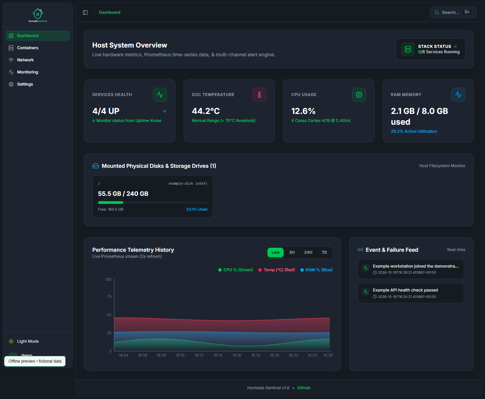

# Homelab Sentinel

**One operating view for a self-hosted environment.**

Homelab Sentinel brings service health, Docker operations, network visibility and alerts into a FastAPI + React dashboard. I built it for my own infrastructure and actively use it on a **Raspberry Pi 5 running Debian-based Linux arm64**.



*The screenshot shows the actual interface with synthetic data. It does not expose a live network or represent measured infrastructure performance.*

[View the light theme](docs/images/dashboard-light-demo.png), also using fictional demonstration data.

## Capabilities

- View system resources, service uptime and recent events.
- Inspect containers, read logs and perform authorized lifecycle operations.
- Discover LAN devices and track changes.
- Configure monitoring and Telegram/Discord notifications.
- Export operational state as JSON or Prometheus metrics.

The application coordinates Prometheus, Grafana and Uptime Kuma rather than replacing their underlying capabilities. SQLite stores application records. A Docker socket proxy mediates container access; deploying this software still grants it operational authority and requires reviewing its configuration.

## Start here

The supported deployment target is a Debian-based **Linux arm64** host with Docker Compose. Raspberry Pi 5 is the tested hardware. Other hardware and amd64 deployment have not been validated.

1. Clone this repository on the target host.
2. Review `.env.example`, the Compose files and installer before running them.
3. Follow the [deployment and operations guide](docs/operations.md#quick-start).
4. Complete the first-run credential change before using operational controls.

See [PORTS.md](PORTS.md) for network bindings and [SECURITY.md](SECURITY.md) for the documented security model. Keep underlying monitoring services private as described in the deployment configuration.

The frontend targets modern browsers: Chrome 111+, Safari 16.4+ and Firefox 128+, following [Tailwind CSS's browser requirements](https://tailwindcss.com/docs/upgrade-guide#browser-requirements).

## Development checks

```sh
python -m venv .venv
. .venv/bin/activate
pip install -r webapp/requirements-dev.txt
python -m pytest webapp/tests -q
cd webapp/frontend
npm ci
npm run build
```

On Windows, activate `.venv\Scripts\Activate.ps1` instead. Backend tests use temporary SQLite data and synthetic accounts; they do not scan a network or control real containers. CI also builds the application Docker image. These checks do not establish hardware compatibility or complete deployment validation.

### Offline dashboard preview

After building the frontend, run `python webapp/tests/preview_server.py` and open `http://127.0.0.1:18765`. Use the fictional `demo` / `demo` login. This read-only dashboard fixture makes no infrastructure connections and is excluded from the production Docker image.

Failed telemetry refreshes now show an explicit warning; an unavailable initial response no longer displays illustrative fallback metrics as if they were live readings.

## More detail

[Operations](docs/operations.md) · [Contributing](CONTRIBUTING.md) · [Security](SECURITY.md) · [MIT license](LICENSE)
